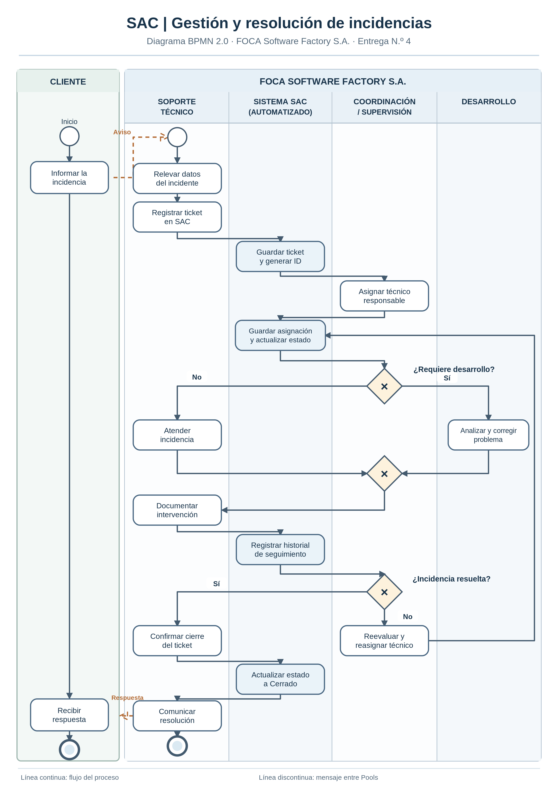

# Trabajo Práctico Integrador — Mejora del sistema SAC

**Organización:** FOCA Software Factory S.A.  
**Asignatura:** Organización Empresarial — Tecnicatura Universitaria en Programación (UTN)  
**Integrante:** Agustín Nair Quattrocchi  
**Proyecto:** Mejora integral del sistema SAC (gestión de tickets e incidencias)

## Descripción del sistema

SAC es un sistema de uso interno de FOCA Software Factory S.A. destinado a registrar, consultar y realizar el seguimiento de tickets e incidencias informadas por los clientes. Facilita el trabajo de soporte técnico, la coordinación de responsables y la intervención del área de desarrollo cuando corresponde.

El proyecto académico propone mejoras en la **estabilidad, el rendimiento y la usabilidad** de SAC, con el propósito de agilizar la atención y el seguimiento de incidencias. Se trata de una propuesta de análisis, modelado y planificación; este repositorio no presenta una implementación completa del software.

## Objetivo y metas del proyecto

El objetivo es mejorar el desempeño de SAC y hacer más eficiente el proceso interno de gestión de tickets. En la Entrega 2 se establecieron las siguientes metas:

- **Rendimiento:** operaciones y consultas habituales con tiempos de respuesta de hasta **3 segundos** en condiciones normales.
- **Estabilidad:** reducción de al menos **50 %** en errores, interrupciones o caídas durante las pruebas, respecto de la versión de referencia.
- **Calidad:** al menos **95 %** de casos de prueba funcionales satisfactorios antes de implementar la nueva versión.
- **Usabilidad:** al menos **80 %** de valoración favorable entre usuarios internos que participen en las pruebas de aceptación.
- **Plazo:** completar las etapas previstas del proyecto en un máximo de **10 semanas**.

Estas cifras son **metas propuestas**, no resultados alcanzados.

## Modelado del proceso de negocio (BPMN)

El proceso modelado comienza cuando un **cliente se comunica con soporte técnico**. El técnico releva la incidencia y registra el ticket en SAC. Luego, un **coordinador o supervisor asigna el ticket** al responsable. La atención puede continuar en soporte o requerir la intervención de desarrollo. El modelo contempla actualizaciones del seguimiento, reevaluación de incidencias no resueltas y cierre una vez solucionado el caso.

El diagrama utiliza participantes (*Pools*), carriles de responsabilidad (*Lanes*) y compuertas para representar decisiones del flujo. Los pasos adicionales de automatización y seguimiento forman parte del **modelo de mejora propuesto** y deben contrastarse con el procedimiento operativo real.

[Consultar archivo BPMN editable](./SAC_BPMN_Una_Hoja_Word.bpmn)

> **Importante:** para que la imagen se visualice, el archivo `README.md` y la imagen `SAC_BPMN_Una_Hoja_Word.png` deben estar en la raíz del repositorio, o se debe ajustar la ruta relativa.

## Documentación del trabajo

- **Entrega 1:** descripción de FOCA, análisis como sistema abierto e identificación del sistema SAC.
- **Entrega 2:** diagnóstico FODA, objetivos, metas cuantitativas y planificación temporal.
- **Entrega 3:** estructura organizacional y diccionario de datos inicial.
- **Entrega 4:** modelado BPMN, trabajo con Git y GitHub, backlog ágil y mecanismos de control.

## Declaración de Uso de IA

Para la elaboración del Trabajo Práctico Integrador se utilizó **ChatGPT** como herramienta de apoyo para organizar las consignas, revisar la redacción, proponer la estructura del flujo BPMN y adaptar su presentación a un formato legible. En las entregas anteriores también se declaró asistencia para la organización de ideas, la revisión documental y la planificación inicial.

### Revisión y correcciones humanas

La asistencia de IA no se incorporó sin revisión. Se precisó que **el cliente no registra directamente el ticket**, sino que se comunica con soporte y un técnico realiza la carga; también se corrigió la asignación para que dependa de **Coordinación/Supervisión**, y se solicitó reorganizar el diagrama para su lectura en una sola hoja de Word. El contenido se contrastó con los objetivos, las áreas involucradas y las entidades de datos descritas en las Entregas 1, 2 y 3.
